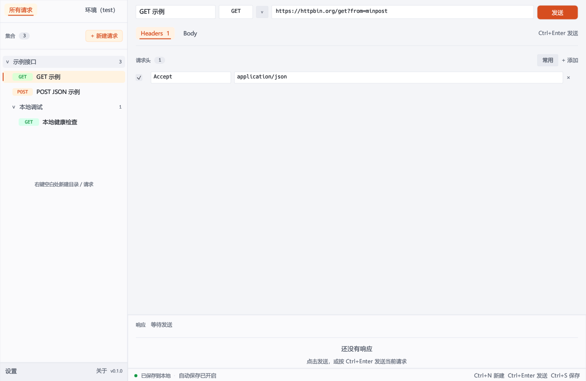
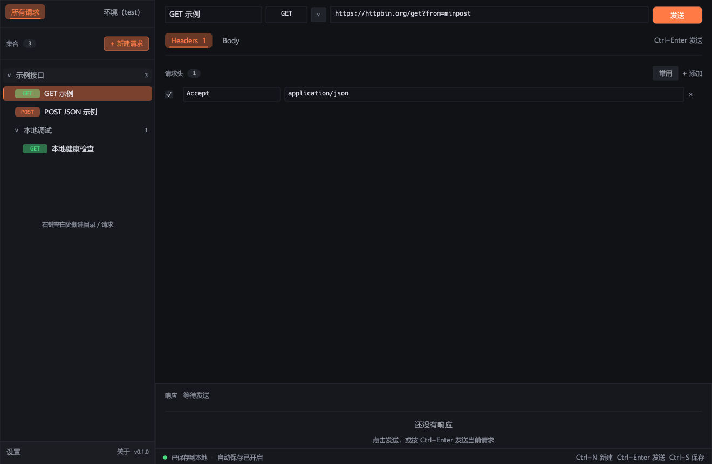

# PostMin

PostMin 是一个使用 **Rust** 编写的轻量级桌面 API 调试工具，交互风格类似 Postman。界面基于 `egui / eframe` 原生渲染，不依赖 Electron、Node.js 或 WebView，发布产物是一个约 7 MB 的单文件 `exe`。





> 截图使用示例数据。

## 功能

- **HTTP 请求**
  - 自定义 Method（常用方法下拉，也支持直接输入任意合法 HTTP Token）
  - URL 自动补全 `http://`，仅允许 `http://` / `https://`
  - Header 新增、删除、启用/禁用，内置常用 Header 快捷添加
  - Body 支持无 / JSON / XML / 文本，JSON、XML 一键格式化
  - 未显式设置 `Content-Type` 时，按 Body 类型自动补充
  - 自定义超时、自动跟随重定向开关
  - 4xx / 5xx 作为正常响应展示，而不是请求错误
- **响应预览**
  - 状态码、状态文案、耗时、响应大小、最终 URL、字符集
  - Body / Headers 分栏
  - JSON / XML 自动美化 + 语法高亮，可切换原文
  - 纯文本原样展示；二进制响应显示元信息与十六进制预览
  - UTF-8 / GBK 等字符集解码；超过 10 MB 的响应会安全截断
  - 一键复制响应体或全部响应头
- **目录树**
  - 无顶部应用栏，界面从集合/请求编辑直接开始
  - 左侧目录上方仅保留「+ 请求」按钮
  - 右键标题 / 空白区域：在根目录新建目录或请求
  - 右键目录：新建请求、新建子目录、重命名、复制、导出、删除
  - 右键请求：打开、重命名、复制、导出、删除
  - 目录与请求均可拖拽排序、移动层级；拖到目录中部放入目录，拖到空白处移动到根目录
  - 拖拽时显示目标插入线 / 目录高亮
  - 支持任意层级目录，编辑自动保存到本地 JSON
- **设置（左侧栏底部菜单）**
  - 外观：浅色（默认）/ 深色主题即时切换并持久化
  - 数据存储：本地工作区路径、打开目录、立即保存、导入 JSON、导出 JSON、复制全部 JSON
  - 网络设置：请求超时、跟随重定向
  - 快捷键说明
- **桌面体验**
  - 中文字体自动回退（Windows 使用系统黑体 / 雅黑）
  - 快捷键：`Ctrl+Enter` 发送、`Ctrl+S` 保存、`Ctrl+N` 新建请求、`Esc` 关闭弹窗
  - 原生 Windows 文件选择框

## 直接运行

已经提供 Windows 发布产物：

```text
dist/PostMin.exe
```

双击即可运行，无需安装 Node.js / Java / WebView 等额外运行时。当前二进制未做代码签名，Windows 可能显示 SmartScreen 提示。

## 从源码构建

### 环境要求

- Windows 10 / 11
- Rust stable（MSVC 工具链）
- Visual Studio 2022 的「使用 C++ 的桌面开发」组件（提供 MSVC 链接器）

```powershell
# 开发运行
cargo run -p postmin-app

# 运行测试
cargo test --workspace

# 静态检查
cargo clippy --workspace --all-targets

# 发布构建
cargo build --release -p postmin-app
# 产物：target\release\postmin.exe
```

构建时间与体积主要来自 GUI / 图形 / HTTP 依赖。本项目在 Windows 10 + Rust 1.99.1 上验证。

## 界面操作

| 操作            | 说明                                          |
| --------------- | --------------------------------------------- |
| 左键目录        | 展开 / 折叠，并设为「新建请求」的目标目录     |
| 左键请求        | 打开到编辑区                                  |
| 右键标题或空白  | 根目录菜单：新建目录 / 新建请求               |
| 右键目录 / 请求 | 对应的复制、重命名、导出、删除菜单            |
| 拖拽目录 / 请求 | 向上/下拖动到插入线排序；拖到目录中部放入目录 |
| 拖到底部空白区  | 移动到根目录末尾                              |
| 左下角「设置」  | 外观、数据存储、网络、快捷键                  |
| 左下角「关于」  | 版本与能力说明                                |

## 数据与存储

默认工作区文件：

```text
%APPDATA%\PostMin\workspace.json
```

写入采用「临时文件 + 备份 + 替换」的方式，并在启动解析失败时自动备份损坏文件。

- 请求编辑会在停止输入约 650 ms 后自动保存。
- 目录展开状态、最后选中的请求、外观主题、网络设置也会持久化。
- 可通过环境变量指定工作区位置，便于便携使用或测试：

```powershell
$env:POSTMIN_DATA_DIR = "D:\PostMinData"
.\PostMin.exe
```

> 注意：集合以明文 JSON 存在本地，Header 中的 Token、Cookie 等敏感信息不会被加密。请勿在共享电脑上保存高敏感凭据。

## 导出 JSON 格式

导出的文件结构如下，可直接再次导入：

```json
{
  "format": "postmin",
  "version": 1,
  "exportedAtUnix": 1770000000,
  "items": [
    {
      "type": "folder",
      "id": "0a1b...",
      "name": "用户模块",
      "expanded": true,
      "children": [
        {
          "type": "request",
          "id": "9c2d...",
          "name": "获取用户",
          "method": "GET",
          "url": "https://api.example.com/users/1",
          "headers": [{ "enabled": true, "key": "Accept", "value": "application/json" }],
          "body": "",
          "bodyKind": "none",
          "autoName": false
        }
      ]
    }
  ]
}
```

导入时同时兼容：

- PostMin 导出的 `export.json`
- 完整 `workspace.json`
- 目录/请求数组 `[...]`
- 单个请求或单个目录对象

导入时会为所有目录与请求重新生成 ID。

## 项目结构

```text
.
├─ crates/
│  ├─ postmin-core/      # 数据模型、HTTP、格式化、存储、拖拽移动算法、单元测试
│  │  └─ src/
│  │     ├─ model.rs
│  │     ├─ http.rs
│  │     ├─ format.rs
│  │     └─ storage.rs
│  └─ postmin-app/       # egui 桌面界面
│     └─ src/
│        ├─ app.rs       # 应用状态、布局、自动保存、导入导出
│        ├─ sidebar.rs   # 集合树、右键菜单、拖拽
│        ├─ request_view.rs
│        ├─ response_view.rs
│        ├─ highlight.rs # JSON / XML 语法高亮
│        ├─ dialogs.rs   # 设置、重命名、删除、关于
│        ├─ theme.rs     # 浅色 / 深色主题
│        └─ widgets.rs
├─ docs/                 # 界面截图
├─ dist/PostMin.exe      # 已构建的 Windows 可执行文件
└─ README.md
```

主要依赖：

- `eframe / egui 0.27`：原生 GUI
- `ureq 2.12 + rustls`：阻塞式 HTTP 客户端，使用系统证书库，运行在后台线程，不阻塞 UI
- `serde / serde_json`：工作区与导入导出
- `quick-xml`：XML 美化
- `encoding_rs`：响应字符集解码
- `rfd`：原生文件选择框
- `uuid`：集合节点 ID

## 设计说明

- HTTP 请求在独立线程执行，通过 `mpsc` 回传结果；UI 线程不阻塞。
- 响应体最多读取 10 MB；美化最多 2 MB；高亮最多 320 KB，避免大响应拖垮界面。
- 请求 Header 名称按 HTTP Token 校验，值禁止 CR/LF，避免 Header 注入。
- 仅允许 `http://` / `https://`，导出文件名会过滤 Windows 非法字符。
- 拖拽移动会在模型层校验：禁止移动到自身、自身子目录，目标类型不匹配时回退失败。

## 已知边界

- 当前版本聚焦「单请求调试」，暂不包含多标签页、Cookie Jar、OAuth 辅助、form-data 文件上传、环境变量等 Postman 高级能力。
- 快捷键当前为固定组合，暂不支持自定义键位。
- 示例集合默认指向 `https://httpbin.org`，内网/离线环境请改成自己的接口地址。
- 预构建二进制仅在 Windows 10 上验证；源码中的界面层理论上可跨平台，但未对 macOS/Linux 做完整测试。
